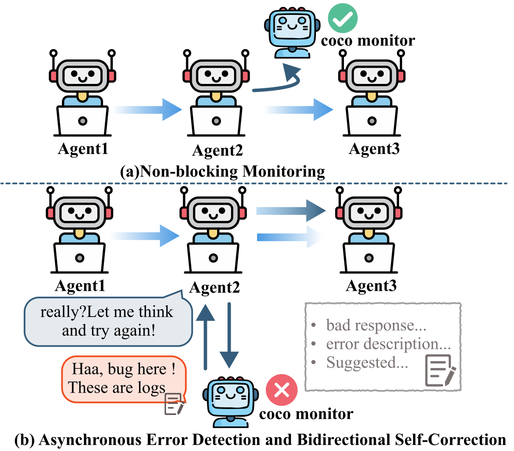
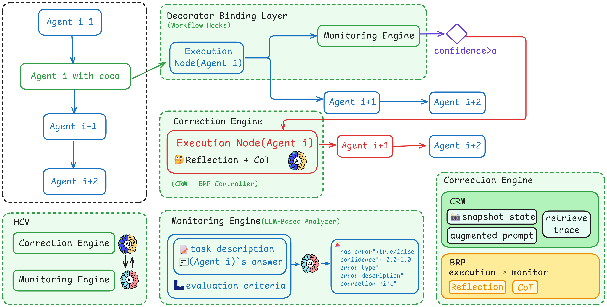

# COCO (Cognitive Operating System with Continuous Oversight)



COCO (Cognitive Operating System with Continuous Oversight) is a theoretically-grounded framework that implements asynchronous self-monitoring and adaptive error correction in multi-agent driven systems. It provides intelligent monitoring and time-travel correction capabilities for LangGraph workflows, enabling LLMs to self-monitor and correct their outputs in real-time.
## 🚀 Key Features

- **🔍 Intelligent Monitoring**: Automatic error detection using LLM-based analysis
- **⏰ Time Travel Correction**: Rollback and replay workflow execution from error points
- **🎯 Seamless Integration**: Simple decorator-based integration with existing LangGraph workflows
- **📊 Configurable Thresholds**: Customizable confidence thresholds for error detection
- **🔄 Self-Correction Loop**: Automatic prompt enhancement with correction hints
- **📈 Performance Logging**: Comprehensive monitoring and correction event logging

## 🏗️ Architecture


COCO implements a three-layer decoupled architecture that achieves intelligent monitoring and automatic correction through seamless integration with multi-agent workflows:

- **Monitor Binding Layer:** Implements loose coupling between monitoring capabilities and workflow execution through non-invasive binding mechanisms. Monitored execution nodes complete their tasks independently and then trigger monitors asynchronously, without blocking the main execution flow. The binding layer supports dynamic configuration of diverse monitoring strategies and ensures state isolation for reliable multi-instance coordination

- **Monitoring Engine:** Implements intelligent quality assessment based on large language models' reasoning. The engine performs multi-dimensional assessment covering logical consistency, format compliance, and content completeness, transforming qualitative judgments into quantitative confidence metrics for threshold-based decisions

- **Correction Engine:** Implements the Contextual Rollback Mechanism and manages workflow state transitions. The engine preserves structured execution snapshots and integrates error diagnostic information with historical context to generate targeted correction strategies. The correction process employs the Bidirectional Reflection Protocol to guide models toward generating correct results.

This architecture supports four error detection categories: logic errors, format errors, content errors, and systematic failures. COCO achieves seamless integration through annotation-based monitoring declarations that require minimal changes to existing workflow implementations.

## 📦 Installation

### Prerequisites

- Python >= 3.12
- ModelScope API Token (required)
- LangSmith (optional, for enhanced monitoring)

### Setup

```bash
# Install dependencies using uv (recommended)
uv sync

# Install the package in development mode
uv pip install -e .

# Set up environment variables
mv .env.example .env
# Edit .env to add your API keys
```

## 📚 Core Components

### 1. `@coco_monitor` Decorator

The main interface for adding CoCo monitoring to your workflow nodes. This decorator wraps LangGraph nodes to provide automatic error detection and correction capabilities.

```python
@coco_monitor(
    node_id="unique_node_identifier",           # Unique identifier for the node
    prompt_template="Evaluation criteria...",   # Template for error detection
    confidence_threshold=0.9,                   # Minimum confidence to trigger correction
    graph_id="workflow_identifier",             # Workflow identifier
    model_config=monitor_config                 # MonitorConfig object
)
```

### 2. `MonitorConfig` Class

Configuration object that defines the monitoring LLM settings. This ensures type safety and proper validation of monitoring parameters.

```python
from src.config import MonitorConfig

config = MonitorConfig(
    model="Qwen/Qwen3-8B",              # Model name
    api_key="your-api-key",             # API key
    base_url="https://api.endpoint",    # API endpoint
    temperature=0.0,                   # Temperature (0.0-1.0)
    top_p=1.0                          # Top-p sampling (0.01-1.0)
)
```

### 3. `coco_execute_workflow` Function

Simplified workflow execution function that automatically integrates CoCo monitoring with LangGraph workflows.

```python
result = await coco_execute_workflow(
    workflow=compiled_graph,            # Compiled LangGraph workflow
    initial_state={"input": "data"},    # Initial state dictionary
    graph_id="unique_id",               # Workflow identifier
    max_wait_time=30.0                  # Maximum execution time
)
```

### 4. Error Detection and Time Travel

CoCo implements a sophisticated error detection and correction mechanism:

**Error Detection Process:**
1. After each monitored node execution, CoCo analyzes the output using the provided `prompt_template`
2. The monitoring LLM evaluates the output and returns a confidence score
3. If confidence exceeds the threshold, time-travel correction is triggered

**Time Travel Mechanism:**
1. **Checkpoint Recovery**: Rolls back to the state before the error-producing node
2. **Prompt Enhancement**: Augments the original prompt with contextual information
3. **Re-execution**: Runs the corrected workflow from the checkpoint
4. **State Preservation**: Maintains all workflow context and variables

## Monitoring and Logging

CoCo provides comprehensive logging capabilities for monitoring workflow execution and correction events:

### Monitor Interaction Logs

CoCo automatically logs all monitoring interactions in structured JSONL format:

**Location**: `../results/monitor_logs/monitor_{node_id}_{date}.jsonl`

**Log Content**:
```json
{
    "timestamp": "2024-08-03T12:37:34.902Z",
    "node_id": "calculator",
    "prompt_length": 256,
    "response_length": 128,
    "has_error": true,
    "confidence": 0.95,
    "error_type": "format_error",
    "error_description": "Response contains calculation process instead of direct answer",
    "correction_hint": "Provide only the numerical result without showing work"
}
```

### Time Travel Event Logs

When time-travel corrections are triggered, CoCo logs these events separately:

**Location**: `../results/monitor_logs/time_travel_events_{date}.jsonl`

**Event Content**:
```json
{
    "timestamp": "2024-08-03T12:37:35.123Z",
    "event_type": "time_travel_triggered",
    "node_id": "calculator",
    "error_type": "format_error",
    "confidence": 0.95,
    "correction_patch_keys": ["error_type", "correction_hint", "failed_output"]
}
```

## ⚙️ Environment Setup

### API Configuration

CoCo requires ModelScope API access. LangSmith integration is recommended for enhanced monitoring.

```bash
mv .env.example .env

# Edit .env file to add your credentials:
# MODELSCOPE_API_KEY=your_modelscope_api_key
# LANGSMITH_API_KEY=your_langsmith_key (optional)
```

### Package Installation

```bash
# Sync dependencies
uv sync

# Install in development mode
uv pip install -e .
```

## 🚀 Quick Start

```bash
# Run the PI calculation demo
cd examples/
uv run calculate_pi.py
```